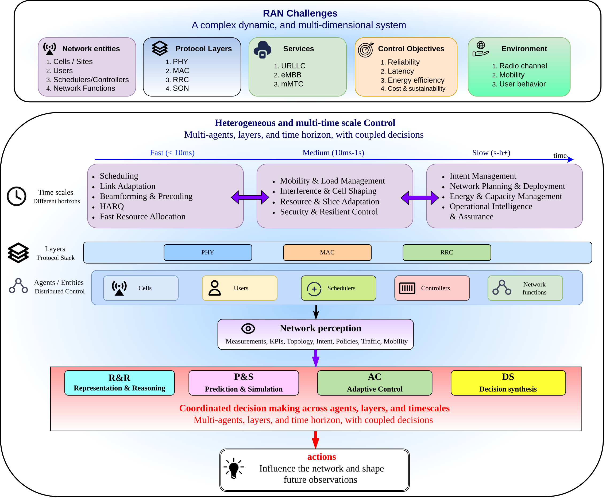
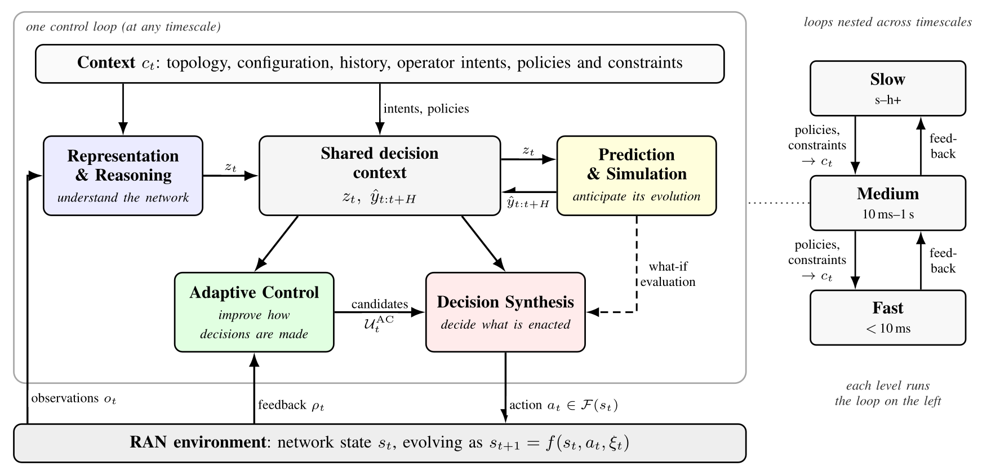
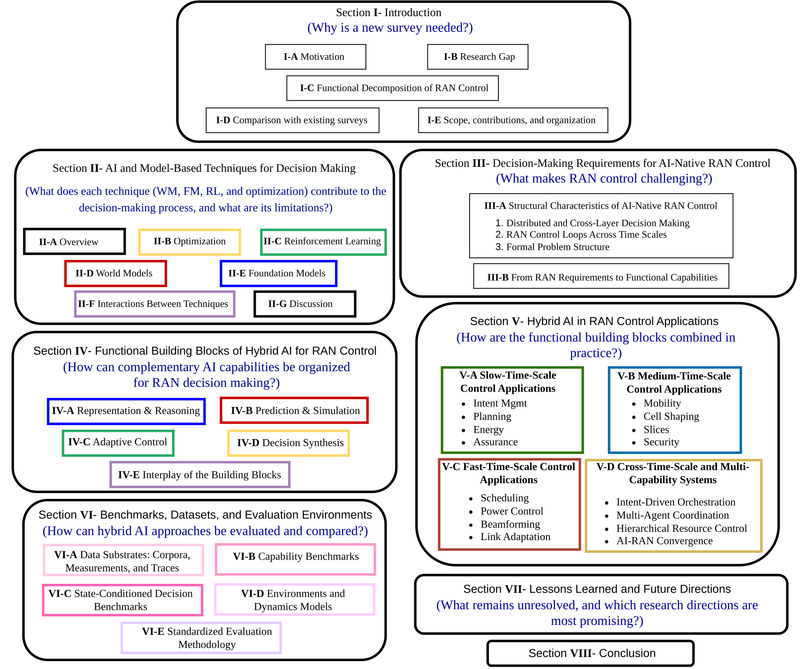

# Awesome Hybrid AI for AI-Native RAN Control

[](https://arxiv.org/abs/2611.33035)
[](https://awesome.re)

[](#contributing)

A curated collection of works on **hybrid AI for radio access network (RAN) control**: how foundation models, world models, reinforcement learning, and optimization are combined to make RAN decisions across protocol layers and control timescales. It accompanies our survey and is organized with the survey's **functional taxonomy**. This list will be continuously updated.

> 📄 **Hybrid AI for AI-Native RAN Control: A Functional Perspective**  
> Sabrine Aroua, Osama Arouk, Pegah Alizadeh  
> *Under review at IEEE Communications Surveys & Tutorials.* Preprint: [arXiv:2611.33035](https://arxiv.org/abs/2611.33035)

<p align="center">
  
</p>
<p align="center"><em>AI-native RAN control as a distributed decision-making system: entities across protocol layers and timescales interact through coupled control loops, which calls for four complementary capabilities.</em></p>

## The Functional Taxonomy

Instead of grouping works by AI technique, the survey asks **which decision-making capability** a component provides. The taxonomy is technique-agnostic: the same capability can be realized by an LLM, a digital twin, an RL agent, or a classical optimizer.

| Block | Capability | Role in the decision process |
|---|---|---|
| **R&R** | Representation & Reasoning | Interpret intents, specifications and network state; build the decision context |
| **P&S** | Prediction & Simulation | Forecast network evolution and evaluate candidate actions (what-if analysis, digital twins, world models) |
| **AC** | Adaptive Control | Adjust control actions online from feedback (RL, adaptive optimization, rule-based adaptation) |
| **DS** | Decision Synthesis | Reconcile objectives, constraints and candidate decisions into a final, executable decision |

<p align="center">
  
</p>
<p align="center"><em>How the four blocks exchange information through a shared decision context within one control loop (left), and how such loops nest across slow, medium and fast timescales (right).</em></p>

Works below are grouped by **application class** and **control timescale**. For each work, ✅ marks the capabilities it explicitly realizes.

## Contents

- [Slow-Timescale Control (minutes to hours)](#slow-timescale-control-minutes-to-hours)
  - [Intent-driven network automation and policy management](#intent-driven-network-automation-and-policy-management)
  - [Network planning, deployment, and configuration](#network-planning-deployment-and-configuration)
  - [Energy and capacity management](#energy-and-capacity-management)
  - [Network operations, assurance, and knowledge management](#network-operations-assurance-and-knowledge-management)
- [Medium-Timescale Control (10 ms to 1 s, Near-RT RIC)](#medium-timescale-control-10-ms-to-1-s-near-rt-ric)
  - [Mobility and load management](#mobility-and-load-management)
  - [Interference and cell-shaping control](#interference-and-cell-shaping-control)
  - [Dynamic resource, slice, and traffic-aware adaptation](#dynamic-resource-slice-and-traffic-aware-adaptation)
  - [Security and resilient control](#security-and-resilient-control)
- [Fast-Timescale Control (below 10 ms)](#fast-timescale-control-below-10-ms)
- [Cross-Timescale and Multi-Capability Systems](#cross-timescale-and-multi-capability-systems)
- [Survey Roadmap](#survey-roadmap)
- [Benchmarks, Datasets, and Evaluation Environments](#benchmarks-datasets-and-evaluation-environments)
- [Citation](#citation)
- [Contributing](#contributing)

## Slow-Timescale Control (minutes to hours)

### Intent-driven network automation and policy management

| Work | R&R | P&S | AC | DS |
|---|:-:|:-:|:-:|:-:|
| [LLM-enabled Intent-driven Service Configuration for Next Generation Networks](https://doi.org/10.1109/NetSoft60951.2024.10588881)<br>*Mekrache & Ksentini — 2024 IEEE 10th International Conference on Network Softwarization (NetSoft), 2024* | ✅ | — | — | — |
| [LLM-Based Intent Processing and Network Optimization Using Attention-Based Hierarchical Reinforcement Learning](https://doi.org/10.1109/WCNC61545.2025.10978505)<br>*Habib et al. — 2025 IEEE Wireless Communications and Networking Conference (WCNC), 2025* | ✅ | ✅ | ✅ | — |
| [An Autonomous Network Orchestration Framework Integrating Large Language Models With Continual Reinforcement Learning](https://doi.org/10.1109/MCOM.001.2400526)<br>*ARC — IEEE Communications Magazine, 2025* | ✅ | — | ✅ | ✅ |
| [Intent-Based Autonomous Network Framework Guided by Large Language Model](https://doi.org/10.1109/TASE.2025.3610906)<br>*IAN — IEEE Transactions on Automation Science and Engineering, 2025* | ✅ | — | ✅ | — |
| [LAMeTA: Intent-Aware Agentic Network Optimization via a Large AI Model-Empowered Two-Stage Approach](https://doi.org/10.1109/JSAC.2025.3642840)<br>*LAMeTA — IEEE Journal on Selected Areas in Communications, 2026* | ✅ | — | ✅ | — |
| [Intent-Based Management of Next-Generation Networks: An LLM-Centric Approach](https://doi.org/10.1109/MNET.2024.3420120)<br>*Mekrache et al. — IEEE Network, 2024* | ✅ | — | — | ✅ |

### Network planning, deployment, and configuration

| Work | R&R | P&S | AC | DS |
|---|:-:|:-:|:-:|:-:|
| [Large Language Model-Based Wireless Network Design](https://doi.org/10.1109/LWC.2024.3462556)<br>*LMCO — IEEE Wireless Communications Letters, 2024* | ✅ | ✅ | — | ✅ |
| [Large Language Model Agents for Radio Map Generation and Wireless Network Planning](https://doi.org/10.1109/LNET.2025.3539829)<br>*Quan et al. — IEEE Networking Letters, 2025* | ✅ | ✅ | — | ✅ |
| [Large Language Models (LLMs) Assisted Wireless Network Deployment in Urban Settings](https://doi.org/10.1109/VTC2024-Fall63153.2024.10757657)<br>*Sevim et al. — 2024 IEEE 100th Vehicular Technology Conference (VTC2024-Fall), 2024* | ✅ | — | ✅ | — |
| [Radio Environment Mapping with World Models for Active Measurement Control: Should Networks Dream of Optimal Control?](https://doi.org/10.1109/EuCNC/6GSummit68295.2026.11577352)<br>*Hribar et al. — 2026 Joint European Conference on Networks and Communications & 6G Summit (EuCNC/6G Summit), 2026* | ✅ | ✅ | — | — |
| [Multi-Objective Deep Reinforcement Learning for 5G Base Station Placement to Support Localisation for Future Sustainable Traffic](https://doi.org/10.1109/EuCNC/6GSummit60053.2024.10597044)<br>*Al-Tahmeesschi et al. — 2024 Joint European Conference on Networks and Communications & 6G Summit (EuCNC/6G Summit), 2024* | — | — | ✅ | — |

### Energy and capacity management

| Work | R&R | P&S | AC | DS |
|---|:-:|:-:|:-:|:-:|
| [MobiWorld: World Models for Mobile Wireless Network](https://arxiv.org/abs/2507.09462)<br>*MobiWorld — arXiv, 2025* | ✅ | ✅ | ✅ | — |
| [Mobile Network Control with a World Model](https://doi.org/10.1109/NOMS69089.2026.11668257)<br>*Bouton et al. — 2026 IEEE/IFIP Network Operations and Management Symposium (NOMS), 2026* | — | ✅ | — | ✅ |
| [Energy Optimization With Multi-Sleeping Control in 5G Heterogeneous Networks Using Reinforcement Learning](https://doi.org/10.1109/TNSM.2022.3157650)<br>*Sleep-mode RL — IEEE Transactions on Network and Service Management, 2022* | — | — | ✅ | — |

### Network operations, assurance, and knowledge management

| Work | R&R | P&S | AC | DS |
|---|:-:|:-:|:-:|:-:|
| [Leveraging Large Language Models for DRL-Based Anti-Jamming Strategies in Zero Touch Networks](https://arxiv.org/abs/2308.09376)<br>*Ali et al. — arXiv, 2023* | ✅ | — | ✅ | — |
| [Automated detection of contradictions in 5G network specifications using reinforcement learning-trained small LLM](https://doi.org/10.1186/s13638-025-02523-3)<br>*Zhang et al. — EURASIP Journal on Wireless Communications and Networking, 2025* | ✅ | — | — | — |
| [Reasoning Language Models for Root Cause Analysis in 5G Wireless Networks](https://arxiv.org/abs/2507.21974)<br>*Sana et al. — 2025* | ✅ | — | — | — |
| [Hyperbolic Spatio-Temporal Graph Learning With Agent Reasoning for Root Cause Localization in Cloud-Edge Microservices](https://doi.org/10.1109/TCCN.2026.3715900)<br>*He et al. — IEEE Transactions on Cognitive Communications and Networking, 2026* | ✅ | — | — | — |
| [Fault Root Cause Analysis via Adaptive Chain of Graph Reasoning in Wireless Networks](https://doi.org/10.1007/978-981-95-8318-8_33)<br>*Wang et al. — Computing and Pattern Recognition (ICCPR), 2026* | ✅ | — | — | — |

## Medium-Timescale Control (10 ms to 1 s, Near-RT RIC)

### Mobility and load management

| Work | R&R | P&S | AC | DS |
|---|:-:|:-:|:-:|:-:|
| [Large Vision Model-Enhanced Digital Twin With Deep Reinforcement Learning for User Association and Load Balancing in Dynamic Wireless Networks](https://doi.org/10.1109/JSAC.2025.3644284)<br>*Tao et al. — IEEE Journal on Selected Areas in Communications, 2026* | — | ✅ | ✅ | — |
| [LLM-Empowered Wireless Channel Quality Prediction for Reliable Cell Handover](https://doi.org/10.1109/MWC.2026.3691074)<br>*Li et al. — IEEE Wireless Communications, 2026* | ✅ | ✅ | — | — |
| [Offline reinforcement learning for mobility robustness optimization](https://arxiv.org/abs/2506.22793)<br>*Alizadeh et al. , — arXiv, 2025* | — | — | ✅ | — |
| [Foundation Model-Based Mobility Management for 6G Mobile Networks](https://doi.org/10.1109/JIOT.2026.3675014)<br>*Lien et al. — IEEE Internet of Things Journal, 2026* | ✅ | — | ✅ | — |
| [Optimization of Handover through Knowledge Graph Enabled Coordination between LLM and O-RAN](https://doi.org/10.1109/FNWF66845.2025.11317210)<br>*Rao et al. — 2025 IEEE Future Networks World Forum (FNWF), 2025* | ✅ | — | — | — |

### Interference and cell-shaping control

| Work | R&R | P&S | AC | DS |
|---|:-:|:-:|:-:|:-:|
| [Tilting and Beam-shaping for Traffic Load Balancing in WCDMA Network](https://doi.org/10.1109/ECWT.2006.280435)<br>*Wu et al. — 2006 European Conference on Wireless Technologies, 2006* | — | — | — | ✅ |
| [Network Parameter Control in Cellular Networks through Graph-Based Multi-Agent Constrained Reinforcement Learning](https://doi.org/10.1109/CASE56687.2023.10260368)<br>*Forsberg et al. — 2023 IEEE 19th International Conference on Automation Science and Engineering (CASE), 2023* | — | — | ✅ | ✅ |
| [Prompting Wireless Networks: Reinforced In-Context Learning for Power Control](https://arxiv.org/abs/2506.06526)<br>*Zhou et al. — arXiv, 2025* | ✅ | — | ✅ | — |
| [Foundation Model-Aided Hierarchical Deep Reinforcement Learning for Blockage-Aware Link in RIS-Assisted Networks](https://doi.org/10.1109/icc59461.2026.11587807)<br>*Ghassemi et al. — Proc. IEEE International Conference on Communications (ICC), 2026* | ✅ | — | ✅ | — |
| [Adaptive Design of mmWave Initial Access Codebooks using Reinforcement Learning](https://arxiv.org/abs/2510.25271)<br>*Aroua et al. — 2026 IEEE 103rd Vehicular Technology Conference (VTC2026-Spring), 2026* | — | — | ✅ | ✅ |

### Dynamic resource, slice, and traffic-aware adaptation

| Work | R&R | P&S | AC | DS |
|---|:-:|:-:|:-:|:-:|
| [Prompt-Tuned LLM-Augmented DRL for Dynamic O-RAN Network Slicing](https://arxiv.org/abs/2506.00574)<br>*PA-MRL — 2025* | ✅ | — | ✅ | — |
| [ORAN-GUIDE: RAG-Driven Prompt Learning for LLM-Augmented Reinforcement Learning in O-RAN Network Slicing](https://arxiv.org/abs/2506.00576)<br>*ORAN-GUIDE — arXiv, 2025* | ✅ | — | ✅ | — |
| [World-Model-Based Adaptive Network Slicing](https://doi.org/10.1109/GLOBECOM59602.2025.11432643)<br>*SliceWM — GLOBECOM 2025 - 2025 IEEE Global Communications Conference, 2025* | — | ✅ | ✅ | — |
| [Tool-Aided Evolutionary LLM for Generative Policy Toward Efficient Resource Management in Wireless Federated Learning](https://doi.org/10.1109/JSAC.2025.3645754)<br>*T-ELLM — IEEE Journal on Selected Areas in Communications, 2026* | ✅ | ✅ | ✅ | ✅ |
| [LLM-xApp: A Large Language Model Empowered Radio Resource Management xApp for 5G O-RAN](https://doi.org/10.14722/futureg.2025.23057)<br>*LLM-xApp — Proceedings 2025 Workshop on Security and Privacy of Next-Generation Networks (FutureG), co-located with NDSS, 2025* | ✅ | — | ✅ | ✅ |
| [Large Language Model-Based Task Offloading and Resource Allocation for Digital Twin Edge Computing Networks](https://doi.org/10.1109/TMC.2026.3664866)<br>*Task Offloading — IEEE Transactions on Mobile Computing, 2026* | ✅ | — | ✅ | ✅ |
| [Serving Long-Context LLMs at the Mobile Edge: Test-Time Reinforcement Learning-Based Model Caching and Inference Offloading](https://doi.org/10.1109/TON.2026.3669011)<br>*T2DRL — IEEE Transactions on Networking, 2026* | — | — | ✅ | — |
| [JPPO++: Joint Power and Denoising-Inspired Prompt Optimization for Mobile LLM Services](https://doi.org/10.1109/TMC.2026.3669711)<br>*JPPO++ — IEEE Transactions on Mobile Computing, 2026* | ✅ | — | ✅ | — |

### Security and resilient control

| Work | R&R | P&S | AC | DS |
|---|:-:|:-:|:-:|:-:|
| [Towards secure intelligent O-RAN architecture: Vulnerabilities, threats and promising technical solutions using LLMs](https://doi.org/10.1016/j.dcan.2025.05.001)<br>*Karbalaee Motalleb et al. — Digital Communications and Networks, 2026* | ✅ | — | ✅ | — |
| [Secure and Trustworthy Open Radio Access Network (O-RAN) Optimization: A Zero-Trust and Federated Learning Framework for 6G Networks](https://doi.org/10.3390/fi17060233)<br>*El-Hajj — Future Internet, 2025* | — | ✅ | ✅ | — |
| [AI-Driven Traffic Steering xApp for Open RAN: A Cloud-Native Quantum-Safe Approach](https://doi.org/10.1109/NetSoft64993.2025.11080591)<br>*Behravesh et al. — 2025 IEEE 11th International Conference on Network Softwarization (NetSoft), 2025* | — | ✅ | — | — |

## Fast-Timescale Control (below 10 ms)

| Work | R&R | P&S | AC | DS |
|---|:-:|:-:|:-:|:-:|
| [Reinforcement Learning-Based Power Control for Reliable Mission-Critical Wireless Transmission](https://doi.org/10.1109/JIOT.2023.3285047)<br>*Guo et al. — IEEE Internet of Things Journal, 2023* | — | — | ✅ | — |
| [Towards Ultra-Reliable 6G in-X Subnetworks: Dynamic Link Adaptation by Deep Reinforcement Learning](https://arxiv.org/abs/2507.12031)<br>*Salehi et al. — arXiv, 2025* | — | — | ✅ | — |
| [Online Frequency Scheduling by Learning Parallel Actions](https://doi.org/10.1109/6GNet63182.2024.10765674)<br>*Giovanidis et al. — 2024 3rd International Conference on 6G Networking (6GNet), 2024* | — | — | ✅ | — |
| [AI-Driven Secure RIS Beam Prediction for O-RAN-Enabled B5G Networks](https://doi.org/10.1109/SATC69565.2026.11542224)<br>*Ismail et al. — 2026 IEEE 2nd International Conference on Secure IoT, Assured and Trusted Computing (SATC), 2026* | — | ✅ | — | — |
| [LLM-Empowered Resource Allocation in Wireless Communications Systems](https://doi.org/10.1109/ACCESS.2026.3655801)<br>*Lee et al. — IEEE Access, 2026* | ✅ | — | — | ✅ |
| [Learning to Coexist: Safe Reinforcement Learning for Terrestrial-Incumbent Spectrum Sharing in the Upper 6 GHz Band](https://doi.org/10.1109/CSCN71666.2026.11771692)<br>*Aroua et al. — 2026 IEEE Conference on Standards for Communications and Networking (CSCN), 2026* | — | — | ✅ | ✅ |

## Cross-Timescale and Multi-Capability Systems

| Work | R&R | P&S | AC | DS | Timescales |
|---|:-:|:-:|:-:|:-:|---|
| [Toward Autonomous O-RAN: A Multi-Scale Agentic AI Framework for Real-Time Network Control and Management](https://doi.org/10.1109/MNET.2026.3701847)<br>*Multi-scale Agentic O-RAN — IEEE Network, 2026* | ✅ | ✅ | ✅ | ✅ | Non-RT / Near-RT / RT |
| [Agentic AI-RAN: Enabling Intent-Driven, Explainable and Self-Evolving Open RAN Intelligence](https://doi.org/10.1109/MNET.2026.3711017)<br>*Agentic AI-RAN — IEEE Network, 2026* | ✅ | ✅ | ✅ | ✅ | Non-RT / Near-RT / RT |
| [AgentRAN: An Agentic AI Architecture for Autonomous Control of Open 6G Networks](https://doi.org/10.1109/MCOM.001.2500563)<br>*AgentRAN — IEEE Communications Magazine, 2026* | ✅ | ✅ | ✅ | ✅ | Sub-ms to minutes |
| [Meta Hierarchical Reinforcement Learning for Scalable Resource Management in O-RAN](https://arxiv.org/abs/2512.13715)<br>*Meta-HRL — arXiv, 2025* | — | — | ✅ | — | Slice-level / scheduling-level |
| [Beyond Connectivity: An Open Architecture for AI-RAN Convergence in 6G](https://doi.org/10.1109/MCOM.001.2500438)<br>*AI-RAN Convergence — IEEE Communications Magazine, 2026* | — | — | — | ✅ | Multi-timescale orchestration |
| [From RAN Control to Agentic Intelligence: Architecture and Vision for Energy Efficient AI-RAN](https://arxiv.org/abs/2606.21955)<br>*E-ARC — arXiv, 2026* | ✅ | ✅ | ✅ | ✅ | Non-RT (SMO / Non-RT RIC) |

## Benchmarks, Datasets, and Evaluation Environments

Resources are ordered by **decision-making depth**, from passive data to full closed-loop interaction. *Block* is the capability a resource mainly supports; *Time* is the decision horizon of its target application class.

### Level 1: Data Substrates — observations only, no declared task

| Resource | Block(s) | Time | Access / Notes |
|---|---|---|---|
| **SPEC5G**<br>[SPEC5G: A Dataset for 5G Cellular Network Protocol Analysis](https://doi.org/10.18653/v1/2023.findings-ijcnlp.3) | R&R | — | Open; tables/equations removed |
| **TSpec-LLM**<br>[TSpec-LLM: An Open-source Dataset for LLM Understanding of 3GPP Specifications](https://doi.org/10.1109/GCWkshp64532.2024.11101012) | R&R | — | Open; preserves structured content |
| **Tele-Data**<br>[Tele-LLMs: A Series of Specialized Large Language Models for Telecommunications](https://doi.org/10.1109/ACCESS.2026.3698683) | R&R | — | Open |
| **OpenTelecom**<br>[TelecomGPT: A Framework to Build Telecom-Specific Large Language Models](https://doi.org/10.1109/TMLCN.2025.3593184) | R&R | — | Release status not stated |
| **CommData**<br>[CommGPT: A Graph and Retrieval-Augmented Multimodal Communication Foundation Model](https://doi.org/10.1109/MCOM.001.2500111) | R&R | — | Release status not stated, Text-only corpus |
| **DeepMIMO**<br>[DeepMIMO: A Generic Deep Learning Dataset for Millimeter Wave and Massive MIMO Applications](https://arxiv.org/abs/1902.06435) | P&S | Fast | Open; ray-traced channels |
| **DeepSense 6G**<br>[DeepSense 6G: A Large-Scale Real-World Multi-Modal Sensing and Communication Dataset](https://doi.org/10.1109/mcom.006.2200730) | P&S | Fast | Open; real measurements |
| **Milan**<br>[A multi-source dataset of urban life in the city of Milan and the Province of Trentino](https://doi.org/10.1038/sdata.2015.55) | P&S | Slow | Open; collected in 2013 |
| **NetMob23**<br>[The NetMob23 Dataset: A High-resolution Multi-region Service-level Mobile Data Traffic Cartography](https://doi.org/10.48550/arXiv.2305.06933) | P&S | Slow | Challenge-based access |
| **OpenRAN Gym traces**<br>[OpenRAN Gym: AI/ML development, data collection, and testing for O-RAN on PAWR platforms](https://doi.org/10.1016/j.comnet.2022.109502) · [ColO-RAN: Developing Machine Learning-Based xApps for Open RAN Closed-Loop Control on Programmable Experimental Platforms](https://doi.org/10.1109/TMC.2022.3188013) | AC | Medium | Open; KPM traces under fixed policies |
| **Twinning**<br>[Twinning Commercial Network Traces on Experimental Open RAN Platforms](https://doi.org/10.1145/3636534.3697320) | P&S | Medium | Open; >500 h, 450 GB |

### Level 2: Capability Benchmarks — one query, one scored answer

| Resource | Block(s) | Time | Access / Notes |
|---|---|---|---|
| **TeleQnA**<br>[TeleQnA: A Benchmark Dataset to Assess Large Language Models Telecommunications Knowledge](https://doi.org/10.1109/MNET.2025.3576035) | R&R | — | Open; 10k MCQ |
| **ORAN-Bench-13K**<br>[ORAN-Bench-13K: An Open Source Benchmark for Assessing LLMs in Open Radio Access Networks](https://doi.org/10.1109/CCNC54725.2025.10975994) | R&R | — | Open; 13.9k MCQ |
| **TeleMath**<br>[TeleMath: A Benchmark for Large Language Models in Telecom Mathematical Problem Solving](https://doi.org/10.1109/MNET.2026.3658826) | R&R | — | Open; numerical answers |
| **TeleTables**<br>[TeleTables: A Benchmark for Large Language Models in Telecom Table Interpretation](https://arxiv.org/abs/2601.04202v1) | R&R | — | Open |
| **Tele-Eval**<br>[Tele-LLMs: A Series of Specialized Large Language Models for Telecommunications](https://doi.org/10.1109/ACCESS.2026.3698683) | R&R | — | Open, no fixed split or seed protocol |
| **srsRANBench**<br>[ORANSight-2.0: Foundational LLMs for O-RAN](https://doi.org/10.1109/TMLCN.2025.3592658) | R&R | — | Open; code-generation tasks |
| **TeleCom-Bench**<br>[TeleCom-Bench: How Far Are Large Language Models from Industrial Telecommunication Applications?](https://doi.org/10.1145/3770855.3817480) | R&R | — | Partially released |
| **CSI-RRG**<br>[CSI-4CAST: A Hybrid Deep Learning Model for CSI Prediction With Comprehensive Robustness and Generalization Testing](https://doi.org/10.1109/tmlcn.2026.3694830) | P&S | Fast | Open, 3,060 scenarios; TDD/FDD |

### Level 3: State-Conditioned Decision Benchmarks

| Resource | Block(s) | Time | Access / Notes |
|---|---|---|---|
| **TeleLogs**<br>[Reasoning Language Models for Root Cause Analysis in 5G Wireless Networks](https://arxiv.org/abs/2507.21974) | R&R | — | Open, synthetic troubleshooting logs |
| **TelecomTS**<br>[TelecomTS: A Multi-Modal Observability Dataset for Time Series and Language Analysis](https://arxiv.org/abs/2510.06063) | R&R, P&S | Medium | Open, real 5G observability data |

### Level 4: Dynamics Models

| Resource | Block(s) | Time | Access / Notes |
|---|---|---|---|
| **Sionna / Sionna RT**<br>[Sionna: An Open-Source Library for Next-Generation Physical Layer Research](https://arxiv.org/abs/2203.11854) · [Sionna RT: Differentiable Ray Tracing for Radio Propagation Modeling](https://doi.org/10.1109/GCWkshps58843.2023.10465179) | P&S | Fast | Open; differentiable simulation |
| **AODT**<br>Aerial Omniverse Digital Twin (AODT) Documentation | P&S | Slow | Hybrid, platform-gated access |

### Level 5: Interactive Environments

| Resource | Block(s) | Time | Access / Notes |
|---|---|---|---|
| **ns-O-RAN**<br>[ns-O-RAN: Simulating O-RAN 5G Systems in ns-3](https://doi.org/10.1145/3592149.3592161) | AC | Medium | Open; E2 interface |
| **Colosseum**<br>[Colosseum: Large-Scale Wireless Experimentation Through Hardware-in-the-Loop Network Emulation](https://doi.org/10.1109/DySPAN53946.2021.9677430) | AC | Medium | Shared testbed |
| **SCOPE**<br>[SCOPE: An Open and Softwarized Prototyping Platform for NextG Systems](https://doi.org/10.1145/3458864.3466863) | AC | Medium | Open, runtime control APIs |
| **ns-O-RAN Gym**<br>[Design and Evaluation of Deep Reinforcement Learning for Energy Saving in Open RAN](https://doi.org/10.1109/ccnc54725.2025.10976108) | AC | Medium | Open, released task and baselines; no fixed split/seed |
| **Wireless Suite**<br>Wireless Suite: A Collection of Problems in Wireless Telecommunications | AC | Fast | Open, complete evaluation protocol; no RIC |
| **FORLORN**<br>[FORLORN: A Framework for Comparing Offline Methods and Reinforcement Learning for Optimization of RAN Parameters](https://doi.org/10.1145/3551661.3561363) | AC | Medium | Open, complete evaluation protocol; no RIC |
| **NetworkGym**<br>[NetworkGym: Reinforcement Learning Environments for Multi-Access Traffic Management in Network Simulation](https://doi.org/10.52202/079017-3385) | AC | Medium | Open, complete evaluation protocol, adjacent domain |
| **EdgeRIC**<br>EdgeRIC: Empowering Real-time Intelligent Optimization and Control in NextG Cellular Networks | AC | Fast | Open, seeding shipped disabled |

> **Gap identified by the survey:** no public resource yet combines closed-loop RAN control with standardized tasks, common metrics, reference baselines, and a fixed seed protocol, i.e. a reproducible closed-loop RAN benchmark.

## Survey Roadmap

The survey goes from decision-making techniques, to the requirements of AI-native RAN control, to the four functional capabilities, their use in applications, the evaluation ecosystem, and open research directions.

<p align="center">
  
</p>

## Citation

If you find this list or the survey useful, please cite:

```bibtex
@article{aroua2026hybrid,
  title   = {Hybrid {AI} for {AI-Native} {RAN} Control: A Functional Perspective},
  author  = {Aroua, Sabrine and Arouk, Osama and Alizadeh, Pegah},
  journal = {arXiv preprint arXiv:2611.33035},
  year    = {2026},
  eprint  = {2611.33035},
  archivePrefix = {arXiv},
  primaryClass  = {cs.AI},
  url     = {https://arxiv.org/abs/2611.33035}
}
```

## Contributing

Missing a work, or think one is classified wrongly? Open an issue or a pull request with the paper link, its application class, and the capabilities (R&R, P&S, AC, DS) it realizes.

This README is generated from the paper sources with [`scripts/build_readme.py`](scripts/build_readme.py).
